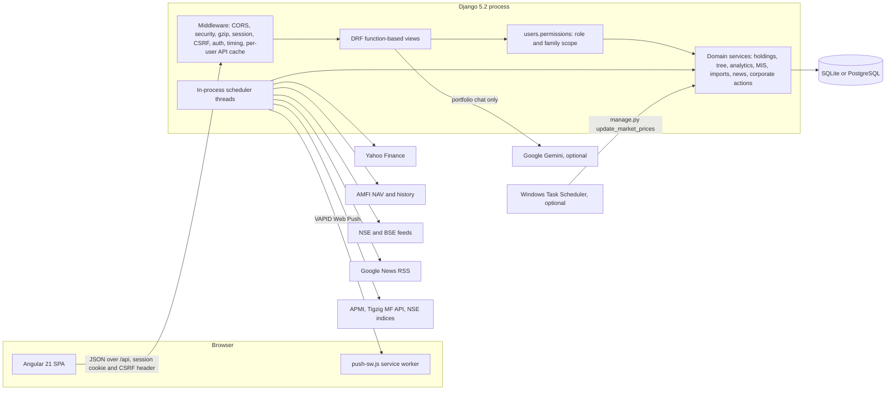
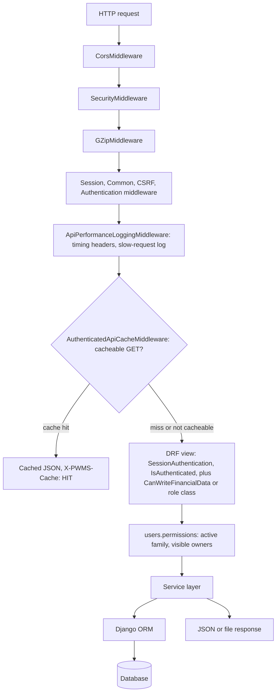
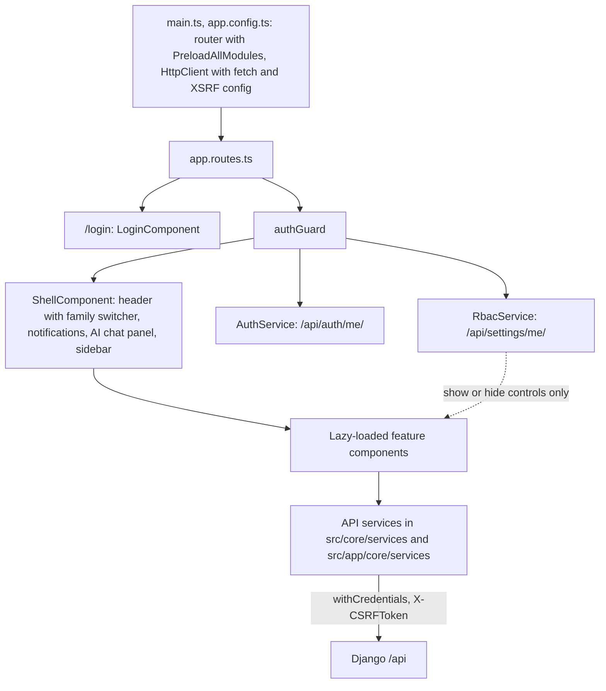
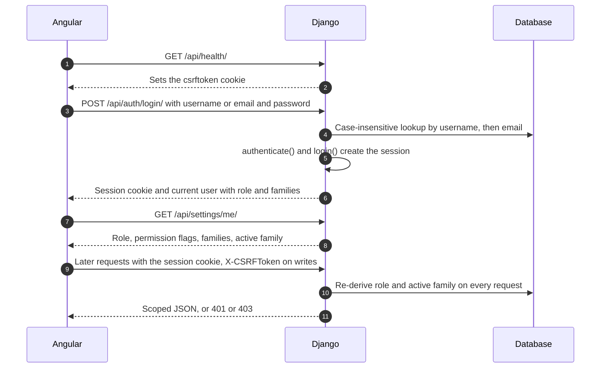
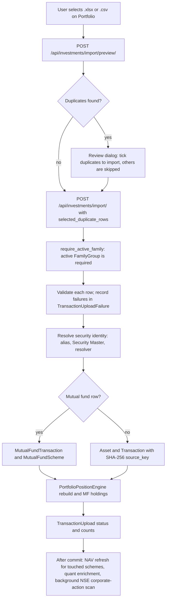
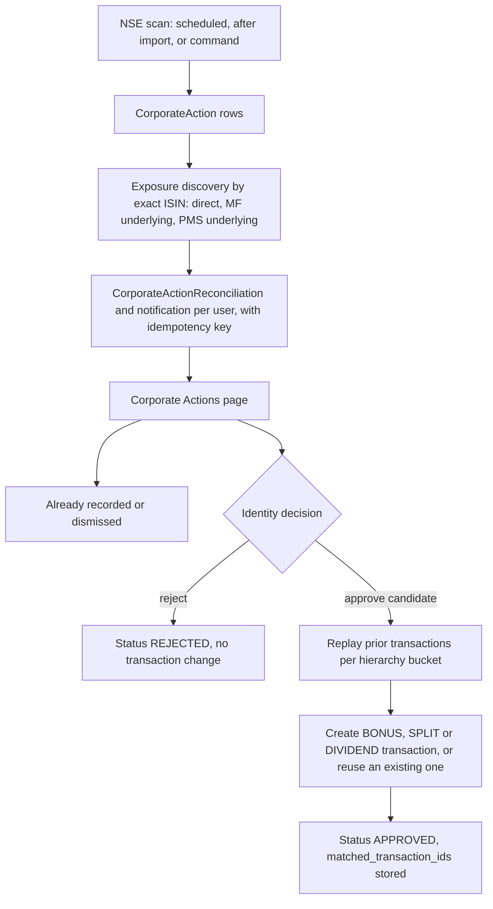
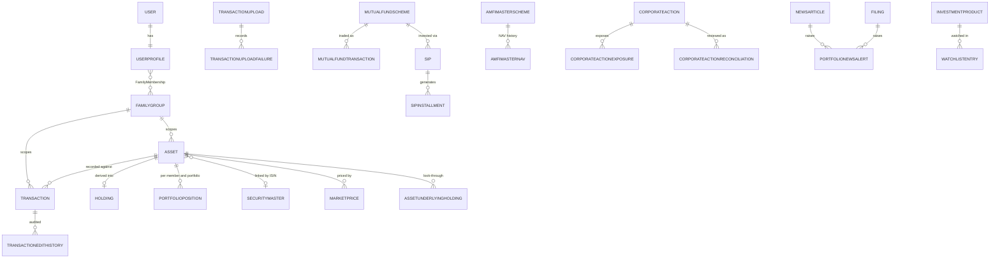

# Personal Wealth Monitoring System

Personal Wealth Monitoring System (PWMS) is a self-hosted web application for tracking a family's investments held in Indian markets. A Django REST backend stores transactions, derives holdings, values them from market and NAV data, and computes returns (XIRR), allocations, MIS reports, tax estimates and liquidity figures. An Angular single-page application presents those results and handles imports, reviews and exports.

The application is built around two separate ideas:

- **Role** (Viewer, Admin, Super User, System Owner) decides what a user may do.
- **Family membership** decides whose financial data a user may see. Every financial record belongs to a family, and each request is scoped to the user's currently active family.

All financial calculations run on the backend. The frontend formats and displays the values it receives, with two exceptions noted under [Reports and data exports](#reports-and-data-exports).

## Contents

1. [Key features](#key-features)
2. [Technology stack](#technology-stack)
3. [System architecture](#system-architecture)
4. [Repository structure](#repository-structure)
5. [Backend architecture](#backend-architecture)
6. [Frontend architecture](#frontend-architecture)
7. [Functional modules](#functional-modules)
8. [Core business workflows](#core-business-workflows)
9. [Database overview](#database-overview)
10. [Authentication and authorization](#authentication-and-authorization)
11. [API reference](#api-reference)
12. [Reports and data exports](#reports-and-data-exports)
13. [Audit logging](#audit-logging)
14. [Prerequisites](#prerequisites)
15. [Installation and setup](#installation-and-setup)
16. [Environment configuration](#environment-configuration)
17. [Background jobs and management commands](#background-jobs-and-management-commands)
18. [Running tests](#running-tests)
19. [Build and deployment](#build-and-deployment)
20. [Troubleshooting](#troubleshooting)
21. [Security considerations](#security-considerations)
22. [Known limitations](#known-limitations)
23. [Contributing](#contributing)
24. [License and disclaimer](#license-and-disclaimer)

---

## Key features

| Area | What is implemented | Frontend route |
| --- | --- | --- |
| Dashboard | Net worth, allocation, Investment Summary, Standard Allocation targets, XIRR rankings, Portfolio Review PDF | `/dashboard` |
| Portfolio | Holdings tree (Family Member → Portfolio → Asset Class → Sub Class → Asset) with invested value, current value, gain and XIRR; transaction import; underlying-holding upload; manual price override | `/portfolio` |
| Transaction Reports | Transaction listing grouped by asset, edit and delete, bulk delete by asset name, ISIN editing, Excel export | `/reports` |
| MIS Report | IPS, Data Sheet, Tax Report (FIFO), Fund Type Summary and editable Notes for a date range; server-generated Excel download | `/mis-report` |
| Liquid Position | Liquid and arbitrage mutual-fund values plus editable bank balances, commitments and deployment plan, per reporting date | `/liquid-position` |
| Downloads | Ten Excel reports, including capital gains, holdings, XIRR summaries, market cap and holding matrix | `/downloads` |
| Analytics | Allocation by asset class, sector, market cap, AMC and advisor; performance; equity and fixed-income analysis; historical wealth | `/analytics` |
| Corporate Actions | NSE corporate-action monitoring, exposure matching, and user review that creates bonus, split or dividend transactions | `/corporate-actions` |
| Portfolio News | Google News RSS monitoring and NSE/BSE filing ingestion, matched to holdings, scored by rules, with optional Web Push | `/portfolio-news` |
| Watch List | Mutual fund (AMFI) and PMS (APMI) research universe, returns, benchmark comparison, personal watch list | `/watch-list` |\n| Mutual Fund Analytics | Imported, dated research report with category overview, fund scorecards, EDGE rankings, calendar/P2P returns, portfolio composition, configurable positioning, full universe and stock-level attribution | `/mutual-fund-analytics` |
| AI Portfolio Chat | Optional Google Gemini chat over the user's own portfolio context | header panel, `/ai-chat` |
| Settings | Account, password, tax settings, logs and audit history, user management, family management, manual prices | `/settings` |

---

## Technology stack

Versions are taken from `backend/requirements.txt`, `frontend/package.json` and the CI workflows.

| Layer | Technology | Declared version |
| --- | --- | --- |
| Backend language | Python | 3.12 in CI; pinned `pandas` and `numpy` require 3.11 or later |
| Web framework | Django | 5.2.17 |
| REST API | Django REST Framework | 3.18.3 |
| CORS | django-cors-headers | 4.9.0 |
| Database | SQLite (default, WAL mode) or PostgreSQL via `psycopg[binary]` | psycopg `>=3.2,<4`; PostgreSQL 16 in CI |
| Data processing | pandas, numpy, openpyxl | 3.0.5, 2.4.6, 3.1.5 |
| Market data | yfinance (with curl_cffi), requests | 1.5.2, 2.34.2 |
| News and filings | feedparser, beautifulsoup4, lxml | 6.0.11, 4.15.0, 6.1.3 |
| Web Push | pywebpush | 2.5.0 |
| WSGI / ASGI servers | waitress, uvicorn (installed; no server configuration is committed) | 3.0.2, 0.52.4 |
| Frontend framework | Angular (standalone components) | 21.2.x |
| Frontend language | TypeScript | ~5.9.2 |
| Node.js | Node.js | 22 in CI; Angular CLI 21 supports `^20.19`, `^22.12` or `>=24` |
| Package manager | npm | `npm@11.12.1` declared in `packageManager` |
| Charts | chart.js, ng2-charts | ^4.5.1, ^10.0.0 |
| Client-side exports | exceljs, jspdf, jspdf-autotable | ^4.4.0, ^4.2.1, ^5.0.8 |
| Frontend tests | Vitest via `@angular/build:unit-test`, jsdom | ^4.0.8, ^28.0.0 |
| AI (optional) | Google Gemini REST API (`generativelanguage.googleapis.com`) | model from `GEMINI_MODEL`, default `gemini-3.6-flash` |

There is no Dockerfile, Celery, Redis or other task queue in the repository. Background work runs in daemon threads inside the Django process, plus an optional Windows Task Scheduler script.

---

## System architecture



In development, `ng serve` proxies `/api` to Django on port 8000, so the browser talks to a single origin. The production frontend build also uses relative `/api` URLs and expects a reverse proxy to route `/api` to Django.

---

## Repository structure

Generated folders (`node_modules/`, `venv/`, `dist/`, `logs/`, `__pycache__/`) are omitted.

```text
Personal_Wealth_Monitoring_System/
├── backend/
│   ├── manage.py
│   ├── requirements.txt
│   ├── .env.example              Environment template (production-style defaults)
│   ├── config/                   Settings, root URLs, middleware, scheduler guard,
│   │                             PostgreSQL advisory lock, pwms_config.json / .py
│   ├── api/                      Health check, login/logout, current user, profile settings
│   ├── users/                    Roles, families, memberships, preferences, tax settings,
│   │                             audit log, permissions.py (central authorization)
│   ├── investments/              Asset, Transaction, Holding, PortfolioPosition, SecurityMaster,
│   │                             security identity/alias models, Excel/CSV importer
│   ├── portfolio/                Portfolio tree, holdings engine, transactions API, MIS report,
│   │                             Liquid Position, holding/market-cap reports, manual prices
│   ├── analytics/                Dashboard view model, unified wealth, XIRR, historical wealth,
│   │                             look-through, Standard Allocation
│   ├── market_data/              MarketPrice, Yahoo/AMFI/bond/SGB providers, schedulers
│   ├── mutual_funds/             Schemes, NAVs, MF transactions and holdings, SIPs,
│   │                             AMFI master, MF underlying disclosures
│   ├── corporate_actions/        Corporate actions, exposures, reconciliations, NSE provider
│   ├── filing_intelligence/      NSE/BSE filing ingestion and rule-based classification
│   ├── portfolio_news/           News retrieval, matching, scoring, alerts, Web Push
│   ├── watchlist/                MF/PMS research universe, performance, benchmarks, peer analytics
│   └── ai/                       Gemini portfolio chat and token-usage log
├── frontend/
│   ├── angular.json, package.json, proxy.conf.json
│   ├── public/                   favicon, push-sw.js (Web Push service worker), sitemap.xml
│   └── src/
│       ├── app/                  Root config and routes, layout (shell, header, sidebar),
│       │                         MIS Report feature and its service, corporate-actions service
│       ├── core/                 auth.guard and API/state services
│       ├── features/             One folder per screen (dashboard, portfolio, reports, ...)
│       ├── shared/               Toast and placeholder components
│       └── environments/         environment.ts / environment.prod.ts (apiUrl)
├── scripts/windows/              Task Scheduler scripts for hourly market-price refresh
├── docs/                         Feature notes, audits and operations notes
├── .github/workflows/            backend-checks.yml, security-audit.yml
├── SETUP.md, SECURITY.md, SECURITY_HARDENING.md, CONTRIBUTING.md, CODE_OF_CONDUCT.md
└── License.md
```

---

## Backend architecture

### Django applications and URL prefixes

Routes are mounted in `backend/config/urls.py`.

| App | URL prefix | Responsibility |
| --- | --- | --- |
| `api` | `/api/` | Health check (also issues the CSRF cookie), login, logout, current user, profile settings, password change |
| `users` | `/api/settings/` | Active family, user and family management, tax settings, manual price list |
| `portfolio` | `/api/portfolio/` | Assets, transactions, tree, summary, holdings, holding/market-cap reports, MIS report, Liquid Position, underlying uploads, manual prices |
| `analytics` | `/api/analytics/` | Dashboard view model and wealth analytics endpoints |
| `mutual_funds` | `/api/mutual-funds/` | MF summary, holdings, transactions, schemes, SIPs, MF underlying |
| `investments` | `/api/investments/` | Transaction import and duplicate preview, upload history, templates, Security Master, security aliases |
| `market_data` | `/api/market-data/stocks/search/` | Yahoo Finance stock and ETF search; price providers and schedulers |
| `ai` | `/api/ai/` | Portfolio chat; also mounts the `portfolio_news` routes |
| `portfolio_news` | `/api/ai/news/`, `/api/ai/notifications/` | News feed, alerts, digest, notifications, push subscriptions |
| `watchlist` | `/api/watch-list/` | Products, filters, performance, benchmarks, watch list membership, refresh |
| `filing_intelligence` | `/api/filings/` | Filing detail |
| `corporate_actions` | `/api/corporate-actions/` | Actions, candidates, notifications, reconciliation decisions |

Django admin is available at `/admin/` for registered models.

### Request processing



- DRF defaults are `SessionAuthentication` and `IsAuthenticated` (`config/settings.py`). Views are function-based (`@api_view`) and add `CanWriteFinancialData`, `IsAdminOrSuperUser` or `IsSystemOwner` where needed.
- `ApiPerformanceLoggingMiddleware` adds `X-PWMS-Request-Time-Ms`, `X-PWMS-DB-Queries`, `X-PWMS-DB-Time-Ms` and `Server-Timing` headers to `/api/` responses, and logs requests slower than `API_SLOW_REQUEST_THRESHOLD_MS` (default 500 ms) without SQL text.
- `AuthenticatedApiCacheMiddleware` caches successful JSON responses for a fixed list of portfolio and analytics GET endpoints for 20 seconds, keyed by user ID, path and query string. A request sent with `Cache-Control: no-cache` bypasses it. The default cache backend is in-process `LocMemCache`.
- Business logic lives in service classes, for example `HoldingCalculationEngine`, `PortfolioPositionEngine`, `PortfolioTreeService`, `UnifiedWealthAnalytics`, `AnalyticsViewModelService`, `MISReportService`, `LiquidPositionService` and `TransactionImporter`.
- Logs are written to `backend/logs/` as rotating files (10 MB, five backups) split by area: `application.log`, `errors.log`, `price_updates.log`, `transactions.log`, `portfolio.log`, `mutual_funds.log`, `watchlist.log`, `news.log`, `filings.log`, `authentication.log` and `imports.log`.

### Configuration layers

- **Secrets and deployment values** come from `backend/.env`, loaded by `python-dotenv` in `config/settings.py`.
- **Non-secret business and provider settings** live in `backend/config/pwms_config.json`: market hours and timezone (`Asia/Kolkata`), news scoring weights and publisher tiers, benchmark sources, provider URLs and timeouts, scheduler intervals, logging limits, database defaults, security-resolver mappings and corporate-action settings. Set `PWMS_CONFIG_OVERRIDES` to a JSON object to override values for a deployment without editing the file.

---

## Frontend architecture



- **Bootstrap.** `app.config.ts` registers the router with `PreloadAllModules` and `HttpClient` with `withFetch()` and an XSRF configuration that reads the `csrftoken` cookie and sends `X-CSRFToken`. There are no HTTP interceptors; services pass `withCredentials: true` and, for writes, fetch a CSRF token from `/api/health/` first.
- **Routing.** `/login` is public. Every other route is a lazy-loaded standalone component under `ShellComponent`, protected by `authGuard`. Unknown paths redirect to `/dashboard`.
- **Guard.** `authGuard` calls `/api/auth/me/` when the session state is unknown and redirects to `/login` on failure. It then loads the role and family state through `RbacService` (`/api/settings/me/`). A failed role lookup does not block navigation; the UI falls back to the most restrictive view and the backend still enforces every permission.
- **State.** Services hold state in RxJS `BehaviorSubject`s and plain fields. There is no NgRx or other store library. `WatchListStateService` and `ThemeService` (light/dark mode) hold client-only state.
- **Charts.** Chart.js through `ng2-charts` on the Dashboard and Analytics pages.
- **Exports.** ExcelJS builds workbooks in the browser for Downloads, Transaction Reports, Holding Reports, Portfolio and Watch List. jsPDF and jspdf-autotable build the Dashboard Portfolio Review PDF (`portfolio-report-pdf.service.ts`).
- **Push notifications.** `BrowserNotificationService` registers `public/push-sw.js` and subscribes through the Push API using the VAPID public key from `/api/ai/notifications/push/config/`.

### Routes

| Route | Component | Sidebar link |
| --- | --- | --- |
| `/login` | `LoginComponent` | none |
| `/dashboard` | `DashboardComponent` | Overview → Dashboard |
| `/portfolio` | `PortfolioComponent` | Portfolio |
| `/mis-report` | `MISReportComponent` | MIS Report |
| `/reports` | `ReportsComponent` | Transaction Reports |
| `/corporate-actions` | `CorporateActionsComponent` | Corporate Actions |
| `/portfolio-news`, `/portfolio-news/:id` | `PortfolioNewsListComponent`, `PortfolioNewsDetailComponent` | Portfolio News |
| `/downloads` | `DownloadsComponent` | Downloads |
| `/liquid-position` | `LiquidPositionComponent` | Liquid Position |
| `/watch-list` | `WatchListComponent` | Watch List |
| `/analytics` | `AnalyticsComponent` | Planning → Analytics |
| `/settings` | `SettingsComponent` | Settings |
| `/ai-chat` | `AiChatComponent` | none; chat is normally opened from the header panel |
| `/reports/holdings` | `HoldingReportsComponent` | none; reachable by URL only |

### Frontend services and backend areas

| Service | Backend prefix |
| --- | --- |
| `auth.service.ts` | `/api/auth/` |
| `rbac.service.ts`, `user-management-api.service.ts`, `settings-price-api.service.ts` | `/api/settings/` |
| `settings-api.service.ts` | `/api/settings/`, tax rates, logs and templates under `/api/investments/` and `/api/portfolio/` |
| `portfolio-api.service.ts`, `manual-price.service.ts`, `liquid-position.service.ts` | `/api/portfolio/` |
| `app/core/services/mis-report.service.ts` | `/api/portfolio/mis-report/` |
| `wealth-api.service.ts` | `/api/analytics/wealth/` |
| `investments-api.service.ts` | `/api/investments/` |
| `news-api.service.ts`, `ai-chat-api.service.ts` | `/api/ai/` |
| `watch-list-api.service.ts` | `/api/watch-list/` |
| `app/core/services/corporate-actions.service.ts` | `/api/corporate-actions/` |

The `/api/mutual-funds/`, `/api/filings/`, `/api/market-data/` and the non-`wealth` `/api/analytics/` endpoints have no frontend consumer in the current code.

---

## Functional modules

### Dashboard and Analytics

The Dashboard loads one backend view model from `GET /api/analytics/wealth/dashboard/` (built by `AnalyticsViewModelService`), with `days`, `period` and `family` query parameters. Analytics uses the granular `/api/analytics/wealth/*` endpoints.

- Current value, invested value, gain and XIRR per asset category, computed by `UnifiedWealthAnalytics` and `XIRRCalculator`.
- **Standard Allocation**: target percentages per asset category, either a global baseline or an override for one Family Member label (`analytics.StandardAllocation`). The percentage is authoritative; the amount is recalculated from current total wealth. Saving requires Admin or above.
- Allocation by advisor, AMC, sector and market cap; equity valuation metrics weighted by current value; fixed-income metrics from Security Master; mutual-fund look-through exposure from disclosed underlying holdings.
- Historical wealth for a rolling period or explicit `start_date`/`end_date` (`HistoricalWealthAnalytics`).
- `POST /api/analytics/wealth/recalculate/` rebuilds derived positions (Admin or above).
- The **Portfolio Review** PDF is generated in the browser from the Dashboard data.

**XIRR.** Cash flows are built in `analytics/services/cash_flows.py` from the investor's point of view. Purchases, SIPs and deposits are negative; sales, dividends, interest and withdrawals are positive, net of fees. `DIVIDEND REINVESTMENT` purchases are skipped as external cash. Current value is the closing inflow. `XIRRCalculator` solves with Newton-Raphson and falls back to bisection.

### Portfolio

`GET /api/portfolio/tree/` returns the holdings hierarchy built by `PortfolioTreeService`: Family Member → Portfolio → Asset Class → Sub Class → Asset (and Underlying). Each node carries quantity, invested value, current value, gain and XIRR.

- **Family Member** is the `Family Name` label from imported transactions (for example, one member of the household). It is different from the `FamilyGroup` that controls data visibility.
- From this page users can import a transaction workbook, upload an asset's underlying holdings (`Stocks`, `% Holding` columns), and set a manual price inline (Admin or above).
- Equity underlyings show a Screener link only when a market symbol can be resolved reliably.

### Transaction import

`TransactionImporter` (`investments/services/transaction_import.py`) accepts `.xlsx` or `.csv`.

- Every worksheet is scanned. A sheet is used as transaction data when a header row contains all of: `Family Name` (or `Family Member`), `Asset Class`, `Sub Class`, `Asset Name`, `Underlying`, `Advisors`, `ISIN`, `Date`, `Trans. Type`, `Quantity`, `Price`, `Amount`. Sheet names and header positions do not matter.
- An optional summary sheet with `Family Name`, `Portfolio Name`, `Asset Class`, `Advisors`, `Asset Name`, `ISIN` maps rows to portfolio names.
- Recognised transaction types: `BUY`, `SELL`, `SIP`, `DIVIDEND`, `DIVIDEND PAYOUT`, `INTEREST`, `DEPOSIT`, `WITHDRAWAL`, `BONUS`, `SPLIT`, `*SPLIT`, `BUYBACK` (stored as SELL), `DIVIDEND REINVESTMENT` (stored as BUY) and `OTHER`.
- Rows whose asset class or sub class is "Mutual Fund" become `MutualFundTransaction` rows. All other rows become `investments.Transaction` rows.
- The standard template is downloadable from `GET /api/investments/transaction-template/` (Settings → Logs → Transaction Uploads).

See [Transaction import and holdings](#transaction-import-and-holdings) for the full flow.

### Transaction Reports

The `/reports` page lists transactions grouped by asset and underlying, supports editing and deleting individual transactions (each change is written to `TransactionEditHistory`), editing asset and underlying ISINs, and exporting summary or date-range Excel files. Deleting every transaction for one asset name (`POST /api/portfolio/transactions/delete-by-asset-name/`) is limited to Super User and System Owner.

### MIS Report

`MISReportService` (`portfolio/mis_report_service.py`) builds the report for the active family between `from_date` and `to_date`.

- **IPS**: market values by asset class and family member for the current and prior period, with differences.
- **Data Sheet**: investment cost, opening market value, period transactions and closing market value.
- **Tax Report**: Data Sheet plus realized and unrealized P/L and tax. Realized P/L uses FIFO lots isolated by asset, family member and portfolio. Buy fees increase cost basis; sell fees reduce proceeds. Splits adjust open lots proportionally; bonuses are zero-cost lots. Short or long term is decided by completed calendar months against the tenure in Tax Settings. Negative P/L produces a negative tax value.
- **Fund Type Summary** and **Notes** (reference rates such as Nifty 50, BSE 500, gold bonds, silver ETF and USD/INR from stored Yahoo Finance history). Notes are editable by Admin or above, and every change is logged.
- Historical valuation reads persisted `MarketPrice` and `AMFIMasterNAV` rows; the interactive report does not download provider data.
- `GET /api/portfolio/mis-report/download/` returns an `.xlsx` workbook generated with openpyxl, named `MIS_Report_<family>_<date>.xlsx`. The download path first refreshes reference prices and builds the report with `ensure_history=True`, which can backfill missing history.
- Values can be displayed as amount, lakhs or crores. Conversion affects presentation only.

### Liquid Position

`LiquidPositionService` produces a family-scoped snapshot for an `as_of` date. Values are shown in rupees lakhs.

- **Liquid (MV)** and **Arbitrage (MV)** are summed from the current values in the portfolio tree for sub classes classified as liquid or arbitrage mutual funds.
- **Bank**, **Commitments** and **Deployment plan** rows are entered by the user and stored in `FamilyLiquidPosition.document` (up to 40 rows per section).
- The backend computes Available liquidity (Liquid + Arbitrage + Bank), **Net available amount** (Available plus the commitment entries as entered), **Total deployment plan** and **Balance**.
- The implementation uses two fixed member columns, `DAJ` and `DJT`. Market values are attributed only to tree rows whose Family Member label matches one of those names (case-insensitive).
- Market values come from current holdings even when an earlier `as_of` date is selected.

### Downloads

The `/downloads` page generates Excel workbooks in the browser with ExcelJS from backend API data:

| Report | Contents |
| --- | --- |
| Portfolio Detailed | Transaction-level activity for a date range |
| Capital Gain Report | FIFO realised gains from sales with indicative tax from saved tax rates; calculated in the browser |
| Liquid Position Funds | The saved Liquid Position for a date, using backend-calculated totals |
| Sub Class Holdings | Current holdings for one sub class |
| Holding Report | Holdings with quantity, invested value, current value, gain and XIRR |
| Portfolio Summary | Sub-class XIRR summary from the portfolio API |
| Asset Name XIRR | Asset-name XIRR summary from the portfolio API |
| Watch List | Watch-listed MF and/or PMS products |
| Market Cap | Equity PMS, direct equity and equity MF exposure by market cap |
| Holding Matrix | Equity PMS and direct equity aggregated by security |

### Corporate actions

- **Sources.** `monitor_corporate_actions --source nse` queries NSE's public corporate-actions JSON once per held NSE symbol. `--source feed` reads a configured authorised feed (`corporate_actions.feed_url` in `pwms_config.json`). `--source filings` derives actions from stored exchange filings. `--source both` runs NSE, the feed (when configured) and filings.
- **Exposure.** Each action is matched to direct holdings, mutual-fund underlying holdings and PMS underlying holdings by exact ISIN. If the source has no ISIN, exact symbol or full security-name candidates are offered for user review instead.
- **Review.** The Corporate Actions page lists notifications per user. A user can mark an item as already recorded or dismissed, or approve or reject a proposed holding identity.
- **Approval.** Approving an identity creates a `BONUS`, `SPLIT` or `DIVIDEND` transaction for each eligible portfolio hierarchy bucket. Bonus entitlement uses holdings on the record date; split and dividend use holdings before the ex-date. Other action types are recorded for review but not converted into transactions.
- **Idempotency.** Reconciliations carry an idempotency key, and an existing same-day action transaction for the same hierarchy is reused instead of duplicated. Approvals run inside `select_for_update` transactions.
- **Valuation effect.** Confirmed split and bonus ratios are applied to quantity (not cost basis) when positions are calculated (`corporate_actions/position_adjustment.py`).
- **Automation.** A completed import starts a background NSE scan. A daily scan at `daily_run_time` (06:00) runs only under `manage.py runserver`.

### Portfolio News and filing intelligence

- **Pipeline.** `run_portfolio_news_monitor` (`portfolio_news/services/pipeline.py`) builds the holdings registry for each active family (direct holdings and uploaded underlyings), generates queries, fetches Google News RSS, matches articles to holdings deterministically on headline and description, de-duplicates articles and sources, and stores `PortfolioNewsMatch` rows.
- **Analysis.** Matches are classified by `RuleBasedArticleAnalyzer`, which uses keyword and event rules and no external AI call. Alerts are scored from impact, portfolio weight, confidence, source quality and recency (weights in `pwms_config.json`) and stored as `PortfolioNewsAlert` with a notification tier.
- **Filings.** On the same schedule, `ingest_exchange_filings` reads NSE's public corporate-announcement feed and BSE only when `EXCHANGE_FILING_FEED_URL_BSE` is set. `filing_intelligence` classifies filings with deterministic rules and links them to securities by ISIN, symbol or BSE code.
- **Delivery.** The UI offers News (raw matches), Alerts and Digest views. Critical and High alerts are sent through Web Push when VAPID keys are configured.
- Further detail: [docs/PORTFOLIO_NEWS_CALCULATION.md](./docs/PORTFOLIO_NEWS_CALCULATION.md), [docs/FILING_INTELLIGENCE.md](./docs/FILING_INTELLIGENCE.md), [docs/NEWS_AGENT_INTELLIGENCE_AUDIT.md](./docs/NEWS_AGENT_INTELLIGENCE_AUDIT.md), [docs/PORTFOLIO_NEWS_LIVE_UPDATES.md](./docs/PORTFOLIO_NEWS_LIVE_UPDATES.md).

`portfolio_news/services/gemini_analyzer.py` still exists, but the pipeline does not call it. Portfolio News does not need a Gemini key.

### Watch List

- **Universe.** `InvestmentProduct` with `MutualFundProduct` (AMFI scheme data, NAV history and fund managers from the Tigzig MF details API) and `PMSProduct` (APMI investment-approach listing). Additional PMS sources can be supplied through `WATCHLIST_PMS_SOURCE_URLS`.
- **Performance.** `PerformanceSnapshot` returns and `BenchmarkMasterPoint` series. Benchmarks are Nifty TRI indices (NSE Indices) and BSE 500 TRI (configured URL or file, with fallbacks in `pwms_config.json`).
- **Watch list.** Each user maintains their own list (`WatchListEntry`) by toggling or bulk-adding products. Refreshing the universe and changing a product's benchmark require Admin or above.
- See [backend/watchlist/BENCHMARKS.md](./backend/watchlist/BENCHMARKS.md) for benchmark source details.

### AI Portfolio Chat

`POST /api/ai/chat/` accepts a `message` of up to 4,000 characters. The backend builds a context from holdings and mutual-fund holdings owned by the requesting user, plus their recent Portfolio News alerts, and sends it to Gemini. If `GEMINI_API_KEY` (or `GOOGLE_API_KEY`) is not set, the endpoint returns HTTP 500 with an explanatory message. Token usage is stored in `GeminiUsageLog`; `manage.py gemini_usage` summarises it.

### Settings

| Tab | Content | Who sees it |
| --- | --- | --- |
| Account, Security | Email and password change. Currency, date format and default analytics period can be changed through `PATCH /api/settings/update/`, but the UI does not show them. | All users |
| Tax Settings | Tenure and short/long-term rates per displayed asset name; template download and Excel upload; conflicting legacy rows flagged for review | All users can read; Admin or above can write |
| Logs | Tax updates, transaction edit history, transaction uploads with row failures, underlying uploads, MIS notes history, security identity mappings, manual prices | Security identity mappings: System Owner. Manual prices: Admin or above. Other logs: all users |
| User Management | Create, edit, activate, deactivate, delete users and reset passwords, within role limits | Admin or above |
| Family Management | Create, rename and delete families; add and remove members | System Owner |

### Backend-only capabilities

These are implemented and routed but have no screen in the current frontend:

- `/api/mutual-funds/*`: mutual-fund schemes, transactions, holdings, SIP creation, due SIPs and SIP or installment execution. SIP installments are also synced and executed by the daily refresh.
- `/api/investments/security-master/`, `security-aliases/`, `underlyings/`, `security-identity-resolution-history/` (the last is used by Settings).
- `/api/market-data/stocks/search/`: Yahoo Finance search.
- Legacy `/api/analytics/summary|allocation|performance|historical/`.

---

## Core business workflows

### Authentication



`POST /api/auth/login/` is CSRF-exempt and ignores any existing session, so a stale session cannot block a new login. Passwords remain case-sensitive. `POST /api/auth/logout/` ends the session.

### Transaction import and holdings



- The duplicate key is a SHA-256 hash of family name, asset class, sub class, asset name, underlying, advisors, ISIN, date, type, quantity, price and amount. A database constraint enforces uniqueness of (`family`, `source`, `source_key`). Duplicates the user selects to import receive distinct keys.
- Holdings use weighted average cost. Buys and SIPs add quantity and amount; a sell removes quantity at the current average cost; bonus and split rows add quantity only; dividend, interest, deposit, withdrawal and other rows do not change the position. Confirmed corporate-action ratios are replayed in date order.
- `python manage.py import_transactions --file <path> --username <user>` runs the same importer from the command line.

### Valuation and price selection

`PortfolioTreeService` selects one current price per asset in this order:

1. The latest manual `MarketPrice` (source `MANUAL`) for the asset.
2. A legacy `ManualAssetPrice` row, if no manual `MarketPrice` exists.
3. For assets identified as mutual funds (by AMFI identity or portfolio hierarchy), the latest `AMFIMasterNAV` matched by ISIN.
4. Otherwise, the latest non-manual, non-AMFI `MarketPrice` (Yahoo Finance, bond or SGB providers).

ETFs stay on market-price routing even when their ISIN also appears in the AMFI master.

### Corporate action review



### Reporting

1. Report pages request scoped data from the portfolio, analytics or MIS endpoints. Each request is scoped to the active family on the server.
2. Calculations (positions, XIRR, MIS FIFO tax, Liquid Position totals) run in backend services. Downloads and Transaction Reports reuse the API values, so exported figures match the screens. The two exceptions are the client-side Capital Gain Report and the Dashboard PDF layout.
3. Excel files are written by ExcelJS in the browser, except the MIS workbook, which the server builds with openpyxl. The Portfolio Review PDF is built with jsPDF.

### Audit trail

Changes to users, tax settings, transactions, MIS notes, security identities and imports are written to append-only log tables and shown under Settings → Logs. See [Audit logging](#audit-logging).

---

## Database overview

The default database is SQLite at `backend/db.sqlite3` (or `SQLITE_DB_PATH`). WAL journal mode, `synchronous=NORMAL` and a 60-second busy timeout are set on each connection. PostgreSQL is selected with `DATABASE_ENGINE=postgresql`. CI runs migrations and the full test suite against both engines.



The diagram shows the main relationships only. See each app's `models.py` for fields and constraints.

| App | Models |
| --- | --- |
| `users` | `UserProfile` (role, active family), `FamilyGroup`, `FamilyMembership`, `UserPreference`, `TaxRateSetting`, `TaxRateChangeLog`, `UserAuditLog` |
| `investments` | `Asset`, `Transaction`, `TransactionEditHistory`, `TransactionUpload`, `TransactionUploadFailure`, `Holding`, `PortfolioPosition`, `SecurityMaster`, `AssetUnderlyingHolding`, `SecurityAlias`, `SecurityIdentityResolutionLog`, `SecurityIdentifierMapping`, `SecurityIdentityDiscoveryCheckpoint` |
| `market_data` | `MarketPrice` (source `YAHOO_FINANCE`, `AMFI`, `MANUAL`, `OTHER`; manual rows record `updated_by`), `ManualAssetPrice` (legacy) |
| `mutual_funds` | `MutualFundScheme`, `MutualFundNAV`, `MutualFundTransaction`, `MutualFundHolding`, `SIP`, `SIPInstallment`, `AMFIMasterScheme`, `AMFIMasterNAV`, `MutualFundUnderlying` |
| `portfolio` | `FamilyMISNotes`, `FamilyMISNotesChangeLog`, `FamilyLiquidPosition` |
| `analytics` | `StandardAllocation` |
| `corporate_actions` | `CorporateAction`, `CorporateActionExposure`, `CorporateActionReconciliation`, `CorporateActionNotification` |
| `filing_intelligence` | `Filing` |
| `portfolio_news` | `NewsArticle`, `NewsArticleSource`, `PortfolioNewsMatch`, `PortfolioNewsAlert`, `PushSubscription` |
| `watchlist` | `InvestmentProduct`, `MutualFundProduct`, `PMSProduct`, `PerformanceSnapshot`, `BenchmarkMasterPoint`, `WatchListEntry`, `DiscoveryRun` |
| `ai` | `GeminiUsageLog` |

Enumerations defined in the models:

- **Asset categories:** `STOCK`, `MUTUAL_FUND`, `ETF`, `FIXED_DEPOSIT`, `GOLD`, `CASH`, `REAL_ESTATE`, `BOND`, `CRYPTO`, `OTHER`.
- **Transaction types:** `BUY`, `SELL`, `SIP`, `DIVIDEND`, `INTEREST`, `DEPOSIT`, `WITHDRAWAL`, `BONUS`, `SPLIT`, `OTHER`.
- **Mutual-fund transaction types:** `PURCHASE`, `SIP`, `REDEMPTION`, `DIVIDEND`.

Financial records carry both an `owner` (the user who created them) and a `family` foreign key. Queries are scoped through `users.permissions.family_scope()`, and rows without a family are excluded by default.

---

## Authentication and authorization

- **Authentication.** Django session cookies with CSRF protection, using DRF `SessionAuthentication`. No token or JWT authentication is implemented. Session cookies are `HttpOnly` and `SameSite=Lax`, and `Secure` when `DEBUG=False`.
- **Single source of truth.** `backend/users/permissions.py` re-derives the role and family memberships from the database on every request and never trusts role or family IDs sent by the client.
- **Profiles.** A `post_save` signal creates a `UserProfile` for every user. Users created with `createsuperuser` (`is_superuser=True`) become System Owner, and the two flags are kept in sync.

### Roles

`VIEWER < ADMIN < SUPER_USER < SYSTEM_OWNER`. The stored value for Super User is `SUPERUSER`.

| Capability | Viewer | Admin | Super User | System Owner |
| --- | :-: | :-: | :-: | :-: |
| Log in and view permitted portfolio data | Yes | Yes | Yes | Yes |
| Edit own profile and password | Yes | Yes | Yes | Yes |
| Change financial data: imports, transactions, manual prices, tax settings, MIS notes, Liquid Position, Standard Allocation, corporate-action decisions, watch-list refresh | No | Yes | Yes | Yes |
| Delete all transactions for an asset name | No | No | Yes | Yes |
| Create users | No | Viewer | Viewer, Admin | Any role |
| Manage users (edit, activate, deactivate, delete, reset password) | No | Viewers | Admins, Viewers | Anyone |
| Change another user's role | No | No | Between Admin and Viewer only | Yes |
| Create and manage families and memberships | No | No | No | Yes |
| View data across all families | No | No | No | Yes |

Nobody can change their own role, and the last active System Owner cannot be deactivated, demoted or deleted. Viewers are read-only through `CanWriteFinancialData`, which allows `GET`, `HEAD` and `OPTIONS` and requires Admin or above for every other method.

### Family scope

- A user can belong to zero, one or many `FamilyGroup`s. Data screens are scoped to the **active family**, which is chosen with the header family switcher (`POST /api/settings/me/active-family/` with `{"family_id": <id>}`). There is no combined multi-family view.
- If the stored active family is no longer valid, the user's lowest-ID family is used.
- A user with no family cannot read or import family-owned financial data. `require_active_family` returns HTTP 403.
- System Owners get cross-family visibility wherever `family_scope()` is used. Endpoints that call `require_active_family()` (including the portfolio tree and imports) still need the System Owner to be a member of an active family, so add the first superuser to a family before using the app.
- Account management is scoped by role only, never by family.

---

## API reference

All endpoints need an authenticated session unless marked "public". Methods listed are those accepted by the view. Write methods on financial endpoints require Admin or above unless noted.

**Auth and profile (`/api/`)**

| Method | Endpoint | Notes |
| --- | --- | --- |
| GET | `/api/health/` | Public; sets the CSRF cookie and returns a token |
| POST | `/api/auth/login/` | Public; body `username` (username or email) and `password` |
| POST | `/api/auth/logout/` | |
| GET | `/api/auth/me/` | Current user, role, families |
| GET | `/api/settings/` | Profile and preferences |
| PATCH | `/api/settings/update/` | `email`, `currency`, `date_format`, `default_analytics_period` |
| POST | `/api/settings/change-password/` | `current_password`, `new_password`, `confirm_password` |

**Settings, users and families (`/api/settings/`)**

| Method | Endpoint | Notes |
| --- | --- | --- |
| GET | `me/` | Role, permission flags, family state |
| POST | `me/active-family/` | Switch active family |
| GET, POST | `tax-rates/` | List or save tax settings |
| PATCH, DELETE | `tax-rates/<id>/` | |
| GET | `tax-rates/template/`, `tax-rates/history/` | Template download, change log |
| POST | `tax-rates/upload/` | Excel upload |
| GET, POST | `users/` | Admin or above |
| GET, PUT, PATCH, DELETE | `users/<id>/` | Role-scoped |
| POST | `users/<id>/activate/`, `users/<id>/deactivate/`, `users/<id>/reset-password/` | Admin or above, role-scoped |
| GET, POST | `groups/` | System Owner |
| PATCH, DELETE | `groups/<id>/` | System Owner |
| POST | `groups/<id>/members/` | System Owner; body `user_id` |
| DELETE | `groups/<id>/members/<user_id>/` | System Owner |
| GET | `prices/` | Assets with current and manual prices |
| GET, PUT, PATCH, DELETE | `prices/<asset_id>/` | Manual price for an asset |

**Portfolio (`/api/portfolio/`)**

| Method | Endpoint | Notes |
| --- | --- | --- |
| GET, POST | `assets/` | |
| GET, PUT, PATCH, DELETE | `assets/<id>/` | |
| GET, PUT, PATCH, DELETE | `assets/<id>/manual-price/` | |
| GET | `assets/<id>/isin-targets/` | ISIN edit targets |
| PATCH | `assets/<id>/isins/` | Update asset or underlying ISINs |
| POST | `assets/<id>/underlying/import/` | Underlying holdings upload |
| GET, POST | `transactions/` | |
| GET, PUT, PATCH, DELETE | `transactions/<id>/` | Edits and deletes are logged |
| POST | `transactions/delete-by-asset-name/` | Super User or System Owner |
| GET | `transactions/edit-history/` | |
| GET | `summary/`, `holdings/`, `tree/` | |
| GET | `holding-report/`, `holding-matrix/`, `equity-market-cap/` | |
| GET | `mis-report/` | `from_date`, `to_date` |
| GET | `mis-report/download/` | `.xlsx` |
| GET, PUT, PATCH | `mis-report/notes/` | |
| GET | `mis-report/notes/history/` | |
| GET, PUT | `liquid-position/` | `as_of` |
| GET | `underlying-template/`, `underlying-uploads/` | |

**Analytics (`/api/analytics/`)**

| Method | Endpoint | Notes |
| --- | --- | --- |
| GET | `wealth/dashboard/` | Dashboard view model; `days`, `period`, `family` |
| GET | `wealth/summary/`, `wealth/allocation/`, `wealth/performance/`, `wealth/xirr/`, `wealth/investment-summary/` | |
| GET | `wealth/performance-by-subclass/`, `wealth/allocation-by-advisor/`, `wealth/performance-by-advisor/`, `wealth/composition-by-amc/` | |
| GET | `wealth/equity-analysis/`, `wealth/fixed-income-analysis/`, `wealth/sector-allocation/`, `wealth/market-cap-allocation/`, `wealth/non-stock-holding-types/` | |
| GET | `wealth/historical/`, `wealth/historical-period/` | `start_date`, `end_date`, `days`, `period` |
| GET | `wealth/standard-allocations/` | |
| PUT | `wealth/standard-allocations/update/` | |
| POST | `wealth/recalculate/` | |
| GET | `summary/`, `allocation/`, `performance/`, `historical/` | Legacy; not used by the frontend |

**Investments (`/api/investments/`)**

| Method | Endpoint | Notes |
| --- | --- | --- |
| POST | `import/preview/` | Duplicate preview; saves nothing |
| POST | `import/` | Multipart `file`, optional `selected_duplicate_rows` |
| GET | `upload-history/`, `upload-history/<id>/` | |
| GET | `transaction-template/`, `underlyings/` | |
| GET | `security-master/` | |
| GET, PATCH | `security-master/<id>/` | |
| GET | `security-identity-resolution-history/` | |
| GET, POST | `security-aliases/` | |
| DELETE | `security-aliases/<id>/` | Deactivates an alias |

**Mutual funds (`/api/mutual-funds/`)**

| Method | Endpoint |
| --- | --- |
| GET | `summary/`, `holdings/`, `transactions/`, `sips/`, `sips/due/`, `sips/summary/`, `underlying/<scheme_id>/`, `csrf/` |
| GET, POST | `schemes/` |
| POST | `transactions/create/`, `sips/create/`, `sips/<id>/execute/`, `sip-installments/<id>/execute/` |

**AI, news and notifications (`/api/ai/`)**

| Method | Endpoint | Notes |
| --- | --- | --- |
| POST | `chat/` | Requires `GEMINI_API_KEY` |
| GET | `news/`, `news/raw/`, `news/digest/`, `news/<alert_id>/` | |
| GET | `notifications/` | |
| POST | `notifications/<alert_id>/read/`, `notifications/read-all/` | |
| GET | `notifications/push/config/` | VAPID public key and enabled flag |
| POST | `notifications/push/subscribe/`, `notifications/push/unsubscribe/` | |

**Watch list (`/api/watch-list/`)**

| Method | Endpoint | Notes |
| --- | --- | --- |
| GET | `filters/`, `products/`, `products/<id>/`, `products/<id>/performance/`, `products/<id>/benchmark-performance/`, `benchmarks-performance/`, `refresh/status/` | |
| PATCH | `products/<id>/benchmark/` | Admin or above |
| POST | `products/<id>/toggle/`, `bulk-add/`, `bulk-remove/` | Any authenticated user (own list) |
| POST | `refresh/` | Admin or above |

**Corporate actions, filings and market data**

| Method | Endpoint | Notes |
| --- | --- | --- |
| GET, POST | `/api/corporate-actions/` | Owner-scoped list; POST creates an action manually |
| GET, PATCH, DELETE | `/api/corporate-actions/<id>/` | |
| GET | `/api/corporate-actions/candidates/` | Exact-identifier candidates |
| GET | `/api/corporate-actions/notifications/` | |
| PATCH | `/api/corporate-actions/notifications/<id>/` | |
| POST | `/api/corporate-actions/reconciliations/<id>/decision/` | `ALREADY_RECORDED` or `DISMISSED` |
| POST | `/api/corporate-actions/reconciliations/<id>/identity-decision/` | `APPROVE` with `asset_id`, or `REJECT` |
| GET | `/api/filings/<id>/` | |
| GET | `/api/market-data/stocks/search/` | `search`, `type`; plain Django view without an authentication check |

---

## Reports and data exports

| Output | Format | Generated by | Location |
| --- | --- | --- | --- |
| MIS Report (IPS, Data Sheet, Tax Report, Fund Type Summary, Notes) | `.xlsx` | Backend (openpyxl) | MIS Report → Download |
| Portfolio Review | `.pdf` | Browser (jsPDF, jspdf-autotable) | Dashboard |
| Downloads catalogue (ten reports) | `.xlsx` | Browser (ExcelJS) from API data | Downloads |
| Transaction summary and date-range exports | `.xlsx` | Browser (ExcelJS) | Transaction Reports |
| Holding reports, portfolio and watch-list exports | `.xlsx` | Browser (ExcelJS) | Holding Reports, Portfolio, Watch List |
| Standard transaction template | `.xlsx` | Backend | Settings → Logs → Transaction Uploads |
| Underlying holdings template | `.xlsx` | Backend | Settings → Logs → Underlyings |
| Tax settings template | `.xlsx` | Backend | Settings → Tax Settings |

Two calculations run in the browser rather than on the backend:

- The **Capital Gain Report** in Downloads computes FIFO realised gains and indicative tax in `downloads.component.ts`. It does not model loss set-off, exemptions, surcharge or cess.
- The **Portfolio Review PDF** layout is assembled in the browser from Dashboard API values.

All other exports reuse values returned by the backend.

---

## Audit logging

| Activity | Storage | Displayed in |
| --- | --- | --- |
| User created, role changed, family added or removed, activated, deactivated, deleted | `users.UserAuditLog` (actor, target, old/new value) | Django admin only |
| Family membership grants | `users.FamilyMembership.added_by` | Family Management |
| Tax setting changes | `users.TaxRateChangeLog` (before/after JSON) | Settings → Logs → Tax Update |
| Transaction edits and deletions | `investments.TransactionEditHistory` (old/new values, changed fields) | Settings → Logs → Transaction Edit History |
| Transaction imports | `investments.TransactionUpload` and `TransactionUploadFailure` (counts, status, failed row data) | Settings → Logs → Transaction Uploads |
| Security identity resolution during import | `investments.SecurityIdentityResolutionLog` | Settings → Logs → Security Identity Mappings |
| Underlying uploads | `investments.AssetUnderlyingHolding.uploaded_by`, `uploaded_at` | Settings → Logs → Underlyings |
| MIS Notes changes | `portfolio.FamilyMISNotesChangeLog` | Settings → Logs → MIS Edit History |
| Manual price changes | `market_data.MarketPrice` rows with source `MANUAL` and `updated_by` | Settings → Logs → Manual Prices |
| Corporate-action decisions | `CorporateActionReconciliation.reviewed_by`, `reviewed_at`, `notes` | Corporate Actions |
| Gemini token usage | `ai.GeminiUsageLog` | `manage.py gemini_usage`, Django admin |

Bulk deletion by asset name writes one aggregate `TransactionEditHistory` row (`operation: bulk_asset_delete`, asset name, deleted count) instead of one row per deleted transaction.

---

## Prerequisites

| Tool | Version |
| --- | --- |
| Git | Any recent version |
| Python | 3.12 recommended (CI); 3.11 or later required by pinned dependencies |
| Node.js | 22 recommended (CI); `^20.19`, `^22.12` or `>=24` for Angular CLI 21 |
| npm | Bundled with Node.js; the repository declares `npm@11.12.1` |
| PostgreSQL | Optional; CI uses PostgreSQL 16 |

Outbound internet access is required for market data, AMFI, news and filing refreshes. The application still starts without it.

---

## Installation and setup

[SETUP.md](./SETUP.md) has a longer walkthrough. The steps below are the minimum needed to run PWMS locally.

### 1. Clone

```bash
git clone https://github.com/avviiiral/Personal_Wealth_Monitoring_System.git
cd Personal_Wealth_Monitoring_System
```

### 2. Backend

Windows PowerShell:

```powershell
cd backend
python -m venv venv
.\venv\Scripts\Activate.ps1
python -m pip install --upgrade pip
python -m pip install -r requirements.txt
"DEBUG=True" | Set-Content .env
python manage.py migrate
python manage.py createsuperuser
python manage.py runserver
```

Linux or macOS:

```bash
cd backend
python3 -m venv venv
source venv/bin/activate
python -m pip install --upgrade pip
python -m pip install -r requirements.txt
printf 'DEBUG=True\n' > .env
python manage.py migrate
python manage.py createsuperuser
python manage.py runserver
```

With `DEBUG=True` and no `SECRET_KEY`, Django generates a temporary key at startup, so sessions are invalidated on every restart. Set `SECRET_KEY` in `.env` to keep sessions across restarts.

Do not copy `backend/.env.example` unchanged for local HTTP development. It sets `SESSION_COOKIE_SECURE=True`, `CSRF_COOKIE_SECURE=True` and `SECURE_SSL_REDIRECT=True`, and browsers will not send secure cookies over `http://localhost`, so login fails.

### 3. Frontend

In a second terminal:

```bash
cd frontend
npm ci
npm start
```

`npm start` runs `ng serve` with the development configuration, which proxies `/api` to `http://localhost:8000` (`frontend/proxy.conf.json`). Open `http://localhost:4200`.

### 4. First use

1. Sign in with the superuser you created. It has the System Owner role.
2. Open **Settings → Family Management**, create a family and add yourself as a member. Financial data and imports require an active family.
3. Select the family in the header switcher if it is not already active.
4. Download the standard transaction template from **Settings → Logs → Transaction Uploads**, fill it in, and import it from **Portfolio**.
5. Create other users from **Settings → User Management** and add them to the family.

### Database setup and migrations

```bash
python manage.py migrate                          # apply migrations
python manage.py makemigrations --check --dry-run # confirm models and migrations agree (run in CI)
python manage.py showmigrations                   # list migration state
```

To use PostgreSQL, create the database and user, then set the following in `backend/.env` and run `python manage.py migrate`:

```ini
DATABASE_ENGINE=postgresql
POSTGRES_DB=pwms
POSTGRES_USER=pwms_user
POSTGRES_PASSWORD=<your-password>
POSTGRES_HOST=localhost
POSTGRES_PORT=5432
```

The repository does not include a script to migrate data from an existing SQLite database to PostgreSQL. See [SETUP.md](./SETUP.md) for the PostgreSQL walkthrough.

---

## Environment configuration

`backend/.env` is read at startup. Never commit it. `backend/.env.example` lists the documented variables with production-style values.

| Variable | Default in code | Purpose |
| --- | --- | --- |
| `SECRET_KEY` | none | Required when `DEBUG=False`; generated per process when `DEBUG=True` |
| `DEBUG` | `False` | Development mode; also sets the defaults for the secure-cookie and SSL-redirect flags |
| `ALLOWED_HOSTS` | empty | Comma-separated host names |
| `CORS_ALLOWED_ORIGINS`, `CSRF_TRUSTED_ORIGINS` | `http://localhost:4200` | Frontend origins (comma-separated) |
| `SESSION_COOKIE_SECURE`, `CSRF_COOKIE_SECURE`, `SECURE_SSL_REDIRECT` | `not DEBUG` | Enable only when HTTPS is in place |
| `SECURE_HSTS_SECONDS`, `SECURE_HSTS_INCLUDE_SUBDOMAINS`, `SECURE_HSTS_PRELOAD` | `0`, `False`, `False` | HSTS |
| `SECURE_REFERRER_POLICY` | `same-origin` | Referrer-Policy header |
| `DATABASE_ENGINE` | `sqlite` | `sqlite` or `postgresql` |
| `SQLITE_DB_PATH` | `backend/db.sqlite3` | SQLite file location |
| `POSTGRES_DB`, `POSTGRES_USER`, `POSTGRES_PASSWORD`, `POSTGRES_HOST`, `POSTGRES_PORT` | from `pwms_config.json` (`pwms`, `pwms_user`, empty password, `localhost`, `5432`) | PostgreSQL connection |
| `POSTGRES_CONN_MAX_AGE` | `60` | Persistent connection lifetime in seconds |
| `CACHE_BACKEND`, `CACHE_LOCATION` | `LocMemCache`, `pwms-api-cache` | Django cache used by the API response cache |
| `API_CACHE_TTL_SECONDS`, `API_CACHE_MAX_ENTRIES` | `20`, `2000` | Cache defaults (the API cache middleware itself uses a fixed 20-second TTL) |
| `API_SLOW_REQUEST_THRESHOLD_MS` | `500` | Slow-request logging threshold |
| `PWMS_CONFIG_OVERRIDES` | empty | JSON object merged into `pwms_config.json` |
| `GEMINI_API_KEY` (or `GOOGLE_API_KEY`), `GEMINI_MODEL` | none, `gemini-3.6-flash` | AI Portfolio Chat only |
| `NEWS_MONITOR_INTERVAL` | `scheduler.news_interval_seconds` (180) | Seconds between news and filing monitor runs |
| `NEWS_MONITOR_LOOKBACK_DAYS`, `NEWS_MONITOR_MAX_ARTICLES_PER_HOLDING`, `NEWS_MONITOR_MAX_BATCH_ARTICLES`, `NEWS_MONITOR_MIN_RELEVANCE_SCORE`, `NEWS_MONITOR_MIN_ALERT_SCORE`, `NEWS_MONITOR_ANALYSIS_DELAY_SECONDS` | `3`, `15`, `50`, `30`, `2.0`, `0` | News pipeline limits |
| `NEWS_CORPORATE_FILINGS_ENABLED`, `NEWS_NSE_FILINGS_ENABLED`, `NEWS_BSE_FILINGS_ENABLED` | `True` | Filing ingestion switches used by the news scheduler |
| `FILING_INTELLIGENCE_ENABLED` | `true` when unset (`.env.example` sets `False`) | Master switch for scheduled filing ingestion |
| `EXCHANGE_FILING_FEED_URL_NSE`, `EXCHANGE_FILING_FEED_URL_BSE` | empty | Authorised filing feed URLs; BSE is skipped when unset |
| `NEWS_EVENT_CLUSTER_WINDOW`, `NEWS_NOTIFICATION_COOLDOWN` | `3`, `86400` | Event clustering window (days), push retry cutoff (seconds) |
| `WATCHLIST_PMS_SOURCE_URLS` | empty | Additional authoritative PMS sources |
| `WATCHLIST_BENCHMARK_BSE500_URL`, `WATCHLIST_BENCHMARK_BSE500_FILE` | empty, `backend/watchlist/data/bse500_tri.csv` | BSE 500 TRI source |
| `WEB_PUSH_VAPID_PUBLIC_KEY`, `WEB_PUSH_VAPID_PRIVATE_KEY`, `WEB_PUSH_VAPID_SUBJECT` | empty | Web Push is enabled when both keys are set |

Example local development `.env` (placeholders only):

```ini
DEBUG=True
SECRET_KEY=<generate-a-random-key>
# Optional
GEMINI_API_KEY=<your-gemini-key>
WEB_PUSH_VAPID_PUBLIC_KEY=<generated-public-key>
WEB_PUSH_VAPID_PRIVATE_KEY=<generated-private-key>
WEB_PUSH_VAPID_SUBJECT=mailto:<you@example.com>
```

Generate a secret key and VAPID keys:

```bash
python -c "from django.core.management.utils import get_random_secret_key; print(get_random_secret_key())"
python manage.py generate_web_push_keys
```

**Frontend.** `frontend/src/environments/environment.ts` and `environment.prod.ts` both set `apiUrl: ''`, so the app calls relative `/api/...` URLs. To point at a different backend origin, set `apiUrl` in the production environment file before building and add that origin's frontend URL to `CORS_ALLOWED_ORIGINS` and `CSRF_TRUSTED_ORIGINS`.

---

## Background jobs and management commands

### In-process schedulers

Schedulers start from `AppConfig.ready()`. `config/scheduler_guard.py` starts them under `manage.py runserver` (only in the autoreloader's worker process) and under any WSGI/ASGI server, and never for other management commands or tests. Two schedulers apply a narrower rule.

| Scheduler | Cadence | Work | Starts under |
| --- | --- | --- | --- |
| `MarketPriceScheduler` | Every 15 minutes | Prices for STOCK, ETF, MUTUAL_FUND and BOND assets and names containing " ETF" | runserver, WSGI/ASGI |
| `DailyRefreshScheduler` | Checks every 30 minutes; runs once per calendar day (marker `backend/data/.last_scheduled_refresh_date`) | `run_scheduled_refresh` | runserver, WSGI/ASGI |
| `InvestmentAMFIScheduler` | Every 30 minutes | Latest AMFI NAVs for held ISINs and missing MIS history | runserver, WSGI/ASGI |
| `MISReferencePriceScheduler` | 20 seconds after start, then every 30 minutes | MIS Notes reference prices | runserver, WSGI/ASGI |
| `SecurityMetricsScheduler` | At start, then every 24 hours | P/E, P/B, PEG, sector and market cap from Yahoo Finance | runserver, WSGI/ASGI |
| `SecurityMasterScheduler` | At start, then every 24 hours | ISIN security master refresh | runserver, WSGI/ASGI |
| `MutualFundUnderlyingScheduler` | At start, then daily at 06:00 IST | Official MF portfolio disclosures | runserver, WSGI/ASGI |
| `PortfolioNewsScheduler` | 10 seconds after start, then every `NEWS_MONITOR_INTERVAL` (180 seconds by default) | News monitor, then exchange filing ingestion | runserver, WSGI/ASGI |
| Watch List refresh (`watchlist/apps.py`) | At start (benchmark history), then daily at 06:00 IST | Benchmark master and Watch List universe | runserver only (`RUN_MAIN=true`) |
| Corporate-action daily scan (`corporate_actions/automation.py`) | Daily at `daily_run_time` (06:00), with catch-up if started later | `monitor_corporate_actions --source nse` | runserver only |

`run_scheduled_refresh` runs `update_market_prices` and `refresh_mis_reference_prices`, then `sync_sip_installments` and `execute_sips` for each active user, then `refresh_security_master --apply`, `monitor_portfolio_news` and `monitor_corporate_actions`. A failing step does not stop the rest. Pass `--skip <command>` to omit a step.

On PostgreSQL, `update_market_prices`, `run_scheduled_refresh` and the market-price scheduler share an advisory lock (`pwms_refresh_pipeline`) so that several processes do not run the same refresh at once. On SQLite the lock does nothing, and background writers share a process-level `RLock`.

### Windows Task Scheduler (optional)

`scripts/windows/register_market_price_scheduler.ps1` registers the task `PWMS-Market-Price-Refresh`. It runs `backend\venv\Scripts\python.exe manage.py update_market_prices` every hour and writes output to `backend\logs\scheduled_market_price_refresh.log`.

```powershell
Set-ExecutionPolicy -Scope Process Bypass
.\scripts\windows\register_market_price_scheduler.ps1
Get-ScheduledTaskInfo -TaskName "PWMS-Market-Price-Refresh"
Unregister-ScheduledTask -TaskName "PWMS-Market-Price-Refresh" -Confirm:$false
```

See [scripts/windows/README.md](./scripts/windows/README.md).

### Management commands

Run from `backend/` with the virtual environment active. Use `python manage.py <command> --help` for options.

| App | Command | Purpose |
| --- | --- | --- |
| `market_data` | `run_scheduled_refresh` | Daily refresh pipeline (see above) |
| `market_data` | `update_market_prices` | Listed-asset price refresh (`--user-id` optional) |
| `market_data` | `refresh_mis_reference_prices` | MIS Notes reference prices |
| `market_data` | `refresh_security_metrics` | Yahoo Finance valuation metrics |
| `market_data` | `fetch_market_data`, `refresh_market_data` | Yahoo Finance history and refresh helpers |
| `investments` | `import_transactions` | Import a workbook (`--file`, plus `--username`, `--user-id` or `--all-users`) |
| `investments` | `refresh_security_master`, `link_security_master`, `load_security_master_data` | Security Master maintenance; report only unless `--apply` |
| `investments` | `import_amfi_cap_classification` | Market-cap classification from an AMFI `.xlsx` |
| `investments` | `discover_security_identities`, `repair_asset_identity`, `refresh_underlying_metadata`, `backfill_price_history` | Identity and data repair utilities |
| `portfolio` | `rebuild_holdings` | Rebuild holdings (`--user-id`, `--asset-id`) |
| `portfolio` | `audit_portfolio_xirr` | XIRR diagnostics |
| `mutual_funds` | `refresh_amfi_master`, `refresh_investment_amfi`, `fetch_amfi_nav` | AMFI master and NAV import (`fetch_amfi_nav --from-date YYYY-MM-DD --to-date YYYY-MM-DD` for history) |
| `mutual_funds` | `sync_sip_installments`, `execute_sips` | SIP installment generation and execution (`--user-id`) |
| `mutual_funds` | `rebuild_mf_holdings`, `recalculate_mf_transactions`, `import_mf_nav`, `resolve_amfi_scheme`, `fetch_mf_underlying` | MF maintenance |
| `corporate_actions` | `monitor_corporate_actions` | `--source nse|feed|filings|both`, `--hours`, `--since`, `--until`, `--dry-run`, `--report-json` |
| `filing_intelligence` | `ingest_exchange_filings` | `--exchange nse|bse` (repeatable), `--hours`, `--dry-run` |
| `filing_intelligence` | `diagnose_corporate_filings` | Read-only filing coverage diagnostics |
| `portfolio_news` | `monitor_portfolio_news` | One news pass (`--loop` to repeat) |
| `portfolio_news` | `generate_web_push_keys` | Generate a VAPID key pair |
| `watchlist` | `refresh_watchlist`, `prepare_watchlist_benchmark_chart` | Watch List universe and benchmark data |
| `ai` | `gemini_usage` | Gemini token usage summary |

---

## Running tests

Backend tests use Django's test runner, with `test*.py` modules in each app. `pytest` is not listed in `requirements.txt`.

```bash
cd backend
python manage.py check
python manage.py makemigrations --check --dry-run
python manage.py test
python manage.py test users portfolio.test_mis_report -v 2   # selected modules
```

PowerShell uses the same commands. CI sets `DEBUG=True`, a placeholder `SECRET_KEY` and `ALLOWED_HOSTS=localhost,127.0.0.1,testserver`, and runs the suite against SQLite and PostgreSQL 16.

Frontend:

```bash
cd frontend
npm run build                  # production build
npm run test -- --watch=false  # Vitest unit tests (app, analytics, portfolio, watch-list specs)
```

CI workflows:

- `.github/workflows/backend-checks.yml`: Django check, migration check and tests on SQLite and PostgreSQL; Angular build and unit tests (Python 3.12, Node 22).
- `.github/workflows/security-audit.yml`: `pip-audit -r backend/requirements.txt` and `npm audit --audit-level=high`. Runs on pushes, pull requests, every Monday and on demand.

---

## Build and deployment

```bash
cd frontend
npm ci
npm run build          # production configuration by default; output in frontend/dist/frontend/browser/
```

The committed configuration does not include a complete production deployment. Verified facts:

- The production frontend calls relative `/api` URLs. Serve `dist/frontend/browser/` and `/api/` from the same origin, for example with a reverse proxy that forwards `/api/` to Django.
- `waitress` and `uvicorn` are installed by `requirements.txt`, and `config/wsgi.py` and `config/asgi.py` exist. The repository contains no server start script, reverse-proxy configuration or service definition.
- `SECURE_PROXY_SSL_HEADER` trusts `X-Forwarded-Proto`. Run Django only behind a proxy that overwrites this header.
- Django admin needs static files: set up `python manage.py collectstatic` (`STATIC_ROOT` is `backend/staticfiles`) and serve that directory.
- Every server process starts its own scheduler threads. With several worker processes, each runs the schedulers; PostgreSQL advisory locks protect only the market-price refresh pipeline. The Watch List refresh and the daily corporate-action scan do not start outside `runserver`. Run `run_scheduled_refresh`, `refresh_watchlist` and `monitor_corporate_actions` from an external scheduler when you are not using `runserver`.
- The API response cache defaults to per-process `LocMemCache`. Set `CACHE_BACKEND` to a shared backend for multi-process deployments.
- `frontend/src/server.ts`, `main.server.ts` and `app.routes.server.ts` exist, but `angular.json` does not enable server-side rendering. The build produces only browser output, so the `serve:ssr:frontend` script has no server bundle to run.
- Web Push needs HTTPS outside `localhost`.

Use the [Django deployment checklist](https://docs.djangoproject.com/en/5.2/howto/deployment/checklist/) and [docs/operations/pwms-production-readiness.md](./docs/operations/pwms-production-readiness.md) before exposing the application.

---

## Troubleshooting

| Symptom | Likely cause and fix |
| --- | --- |
| `RuntimeError: SECRET_KEY must be configured when DEBUG=False.` | Set `SECRET_KEY` in `backend/.env`, or set `DEBUG=True` for local development. |
| Login appears to succeed, then every request returns 403 | Secure cookies over HTTP. Remove `SESSION_COOKIE_SECURE`, `CSRF_COOKIE_SECURE` and `SECURE_SSL_REDIRECT` from a local `.env` or set them to `False`. |
| "You must belong to an active family to access family-owned financial data." | Add the user to a family in Settings → Family Management and select it in the header. |
| Logged out after every backend restart | `SECRET_KEY` is unset with `DEBUG=True`, so a new key is generated per start. Set a fixed key. |
| API calls fail from `http://localhost:4200` | Start the backend on port 8000. `ng serve` proxies `/api` there. |
| `database is locked` with SQLite | Concurrent background writes. WAL mode and a 60-second busy timeout reduce this; use PostgreSQL for heavier use. |
| Prices or NAVs missing | External provider unavailable or the symbol cannot be resolved. Check `backend/logs/price_updates.log`, then set a manual price. |
| AI chat returns "GEMINI_API_KEY is not configured on the backend." | Set `GEMINI_API_KEY` and restart Django. |
| No push notifications | Set both VAPID keys, restart Django, allow notifications in the browser, use HTTPS outside localhost. Only Critical and High alerts are pushed. |
| Liquid Position shows zero market values | Family Member labels in transactions must be `DAJ` or `DJT`, and the sub class must contain "liquid" or "arbitrage" with a mutual-fund asset class. |
| Values look stale for a few seconds after an edit | The per-user API cache holds selected GET responses for 20 seconds. |
| Slow pages | Check the `X-PWMS-Request-Time-Ms` and `X-PWMS-DB-Queries` response headers and the slow-request warnings in the application log. |

---

## Security considerations

- Authorization is enforced on the server for every request. The frontend `RbacService` only hides controls.
- `.env`, `*.sqlite3`, logs and secret files are git-ignored. Only `backend/.env.example` is committed. Keep `WEB_PUSH_VAPID_PRIVATE_KEY`, `SECRET_KEY`, database passwords and `GEMINI_API_KEY` server-side.
- With `DEBUG=False`, secure cookies and the HTTPS redirect are on by default. `X-Frame-Options: DENY`, `nosniff`, `Cross-Origin-Opener-Policy: same-origin` and a configurable Referrer-Policy are always set. HSTS is off until `SECURE_HSTS_SECONDS` is set.
- Data sent to third parties: ticker symbols to Yahoo Finance; holding names and identifiers as Google News search queries; scheme codes to the Tigzig MF API; APMI investment-approach IDs; NSE symbols to NSE. AMFI files are downloaded with no user data. The Gemini chat sends the requesting user's portfolio context to Google, and only when a key is configured and the user sends a message.
- `/api/health/` and `/api/market-data/stocks/search/` are reachable without logging in. The search endpoint forwards the query to Yahoo Finance.
- `/api/auth/login/` is CSRF-exempt by design. No login rate limiting or account lockout is implemented in the code.
- Dependency audits run in `security-audit.yml`. See [SECURITY.md](./SECURITY.md) for reporting vulnerabilities and [SECURITY_HARDENING.md](./SECURITY_HARDENING.md) for hardening notes.

---

## Known limitations

- **Single-process background design.** Schedulers are daemon threads inside the web process. Multi-worker deployments need care (see [Build and deployment](#build-and-deployment)).
- **SQLite by default.** Suitable for a single household. No automated backup is included.
- **Liquid Position member columns are fixed** to `DAJ` and `DJT` in `LiquidPositionService`.
- **External data sources** (Yahoo Finance, AMFI, NSE, BSE, APMI, Tigzig, Google News) can be delayed, change format or block requests. Missing values are left unavailable rather than estimated.
- **BSE filings** need an authorised feed URL. The configured NSE providers use public endpoints and do not bypass access controls.
- **Portfolio News is rule-based.** Classification and scoring use keywords and configured weights, not semantic understanding.
- **Capital Gain Report** in Downloads is indicative and calculated in the browser.
- **No frontend screen** exists for the mutual-fund/SIP API or Security Master editing.
- **Unused code.** `src/app/core/services/auth.service.ts` (the app uses `src/core/services/auth.service.ts`), `portfolio_news/services/gemini_analyzer.py`, and the unrouted `prepare_watch_list` and `prepare_watch_list_benchmark` views in `watchlist/views.py`.

---

## Contributing

See [CONTRIBUTING.md](./CONTRIBUTING.md) and [CODE_OF_CONDUCT.md](./CODE_OF_CONDUCT.md). Pull requests use `.github/PULL_REQUEST_TEMPLATE.md`.

Before opening a pull request:

1. Branch from `main`. CI also runs on `feature/**`, `fix/**`, `audit/**` and `hardening/**` pushes.
2. Run `python manage.py check`, `python manage.py makemigrations --check --dry-run` and `python manage.py test` in `backend/`.
3. Run `npm run build` and `npm run test -- --watch=false` in `frontend/`.
4. Protect new endpoints with the classes in `users/permissions.py` and scope financial queries with `family_scope()` or `require_active_family()`.
5. If you change roles or capabilities, update the matrix in the `users/permissions.py` docstring and the table in this README.

---

## License and disclaimer

Proprietary software. See [License.md](./License.md).

PWMS is a record-keeping and analytics tool. It does not provide investment, tax or legal advice. Prices, NAVs, filings and news come from third parties and may be delayed or wrong. Tax figures are estimates. Reconcile against broker, depository and AMC statements before acting on any figure.


### Mutual Fund Research Report Import

The Mutual Fund Analytics screen reads a dated research snapshot imported from the supplied Nexedge HTML report. The importer extracts the report's `RAW`, `P2P` and `ATTR` JSON objects without executing the HTML or its JavaScript. It stores the original payload as a report snapshot and does not overwrite live Watch List products, NAVs or portfolio positions.

Run from the backend directory:

```powershell
python manage.py migrate
python manage.py import_mutual_fund_research_report --file "D:\path\to\Nexedge_multicap_dashboard_Oct2026.html"
```

The import is repeatable for the same report key and report date. A later report date becomes the latest dashboard snapshot. The API is authenticated at `GET /api/watch-list/analytics/research-report/`. The report's own coverage is preserved: RAW universe count, P2P-covered count and ATTR-covered count are distinct and should not be assumed to match. Imported reports are historical research snapshots, not live data.
